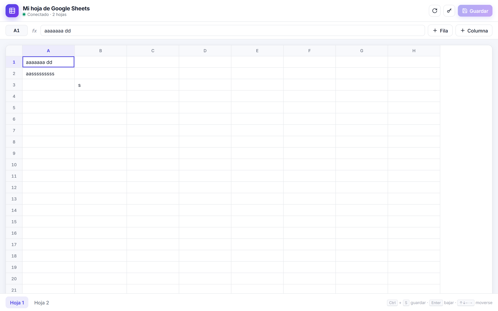
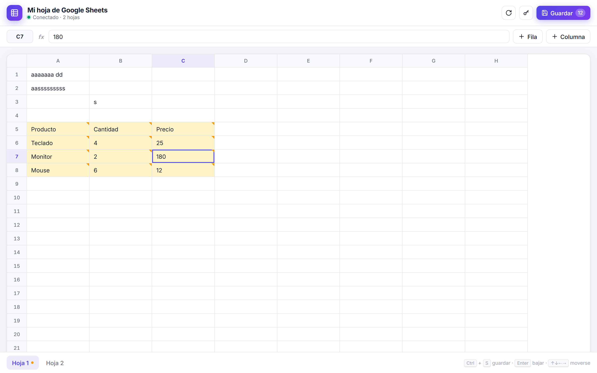
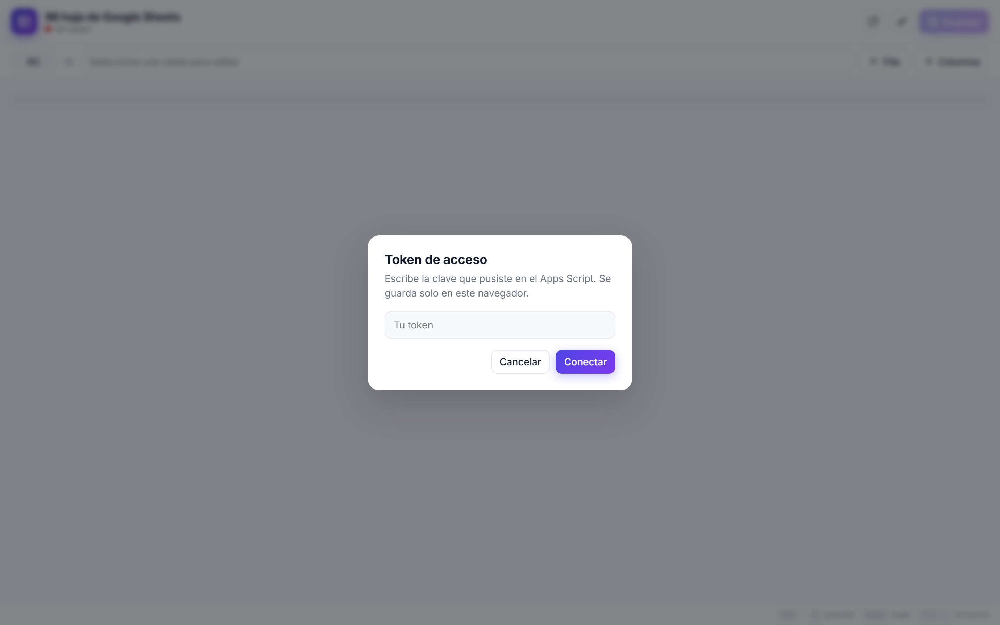

<div align="center">

# Editor web para Google Sheets

**Consulta y edición de hojas de Google Sheets desde una interfaz web propia, sin iniciar sesión con Google.**


Diseñado y desarrollado por **Alvaro Siles Estrada** — Ingeniero de Sistemas · Full Stack Developer · 15 años de experiencia



</div>

---

## Índice

1. [Descripción](#1-descripción)
2. [Características](#2-características)
3. [Arquitectura](#3-arquitectura)
4. [Estructura del proyecto](#4-estructura-del-proyecto)
5. [Tecnologías](#5-tecnologías)
6. [Módulos](#6-módulos)
7. [Modelo de datos](#7-modelo-de-datos)
8. [API](#8-api)
9. [Instalación y configuración](#9-instalación-y-configuración)
10. [Ejecución y despliegue](#10-ejecución-y-despliegue)
11. [Seguridad](#11-seguridad)
12. [Limitaciones conocidas](#12-limitaciones-conocidas)
13. [Hoja de ruta](#13-hoja-de-ruta)
14. [Documentación legal y de proyecto](#14-documentación-legal-y-de-proyecto)
15. [Autor](#15-autor)

---

## 1. Descripción

Editar una hoja de Google Sheets normalmente exige una cuenta de Google con permisos sobre el archivo, y la opción "Publicar en la web" solo ofrece lectura.

Este proyecto resuelve ese problema con una arquitectura serverless mínima:

- un script de **Google Apps Script** expone la hoja como **API JSON** protegida por token;
- una **página estática sin dependencias** ofrece una experiencia de edición similar a la de una hoja de cálculo.

El resultado es una herramienta ligera para consultar y actualizar datos desde la web, sin servidor propio, sin base de datos tradicional y sin gestionar cuentas de Google para cada persona usuaria.

## 2. Características

**Datos y sincronización**
- Lectura de **todas las pestañas** de la hoja en una sola petición.
- **Guardado incremental:** solo se envían las celdas modificadas, agrupadas por pestaña. Las fórmulas y los datos no editados se conservan.
- Los cambios pendientes se mantienen al cambiar de pestaña.

**Experiencia de edición**
- Cuadrícula con encabezados de columna (A, B, C…) y de fila fijos al hacer scroll.
- **Barra de fórmula** con la referencia de la celda activa (p. ej. `C7`), editable.
- Resaltado de la celda activa y de su fila y columna.
- Cambios pendientes visibles: celdas en amarillo, contador en **Guardar** e indicador en cada pestaña.
- Botones para añadir filas y columnas. Tamaño mínimo configurable (30 × 8 por defecto).
- Atajos: `Ctrl/Cmd + S` guardar · `Enter` y flechas para moverse · `Esc` cerrar la ventana del token.

**Interfaz**
- Indicador de estado de conexión, pantalla de carga y avisos de éxito o error.
- Ventana modal de acceso por token.
- Aviso antes de cerrar la página con cambios sin guardar.
- Tema claro y oscuro automático, y diseño adaptable a móviles.



## 3. Arquitectura

```
┌──────────────────────────┐   GET  ?token=…                  ┌───────────────────────────┐        ┌──────────────────┐
│  index.html (navegador)  │ ───────────────────────────────▶ │ Google Apps Script        │ ─────▶ │  Google Sheets   │
│  HTML + CSS + JS nativo  │   POST {token, hoja, cambios}    │ (aplicación web /exec)    │        │  (hoja vinculada)│
│  token en localStorage   │ ◀─────────────────────────────── │ doGet / doPost → JSON     │ ◀───── │                  │
└──────────────────────────┘          JSON                    └───────────────────────────┘        └──────────────────┘
```

| Capa | Implementación |
|---|---|
| Presentación | Página estática sin framework ni compilación; se comunica con la API mediante `fetch`. |
| Servicio | Google Apps Script publicado como aplicación web: se ejecuta con la identidad del propietario y es accesible para "Cualquiera", protegido por token. |
| Persistencia | La propia hoja de Google Sheets vinculada al script. |

### Decisiones técnicas

- **CORS sin servidor intermedio.** Los `POST` se envían con `Content-Type: text/plain;charset=utf-8`. Así el navegador no lanza el *preflight* `OPTIONS`, que Apps Script no responde. El cuerpo sigue siendo JSON y el servidor lo interpreta con `JSON.parse`.
- **Escritura por celda modificada** en lugar de reescribir rangos completos, para no sobrescribir fórmulas ni contenido ajeno a la edición.
- **El secreto no va en el frontend.** El token se solicita en tiempo de ejecución y se guarda en el navegador de cada persona, porque el sitio es estático y el repositorio público.
- **Cero dependencias.** Todo el frontend vive en un solo archivo organizado por secciones, sin npm ni bundler, para que el despliegue y el mantenimiento sean triviales.

## 4. Estructura del proyecto

```
proyecto/
├── index.html            # Frontend: estilos, marcado y lógica
├── apps-script.gs        # Backend: API en Google Apps Script
├── presentacion/         # Capturas de la aplicación en funcionamiento
├── README.md             # Documentación técnica
├── version-portafolio.md # Presentación del proyecto para portafolio
├── CHANGELOG.md          # Historial de cambios
├── SECURITY.md           # Política de seguridad
├── PRIVACY.md            # Política de privacidad
├── TERMS.md              # Términos de uso
└── LICENSE               # Licencia MIT
```

Organización interna de `index.html`:

| Sección | Responsabilidad |
|---|---|
| `<style>` | Tokens de color claro/oscuro, componentes y adaptación a móviles |
| `CONFIGURACIÓN` | `URL_API`, `FILAS_MINIMAS`, `COLUMNAS_MINIMAS` |
| `ESTADO` | `hojas`, `hojaActual`, `cambios`, `inputs`, `seleccion` |
| `UTILIDADES` | Letras de columna, contador de cambios, avisos, estado de conexión |
| `TOKEN` | Persistencia en `localStorage` (clave `tokenHoja`) y modal de acceso |
| `DIBUJAR` | Render de pestañas y cuadrícula |
| `EDITAR Y MOVERSE` | Registro de cambios, selección, teclado, barra de fórmula |
| `CARGAR Y GUARDAR` | Comunicación `GET` / `POST` con la API |
| `BOTONES Y ATAJOS` | Eventos, `Ctrl+S`, `Esc`, aviso `beforeunload` |

## 5. Tecnologías

| Capa | Tecnología |
|---|---|
| Frontend | HTML5 · CSS3 (custom properties, `sticky`, `color-mix`, `backdrop-filter`) · JavaScript ES2017+ (`async/await`, `fetch`, `localStorage`) |
| Backend | Google Apps Script (`SpreadsheetApp`, `ContentService`) |
| Datos | Google Sheets |
| Diseño | Tipografía Inter (Google Fonts) · iconos SVG en línea |
| Hosting | Compatible con GitHub Pages o cualquier hosting estático |

Sin `package.json`, dependencias npm, bundler ni framework.

## 6. Módulos

| Módulo | Función |
|---|---|
| **Lectura** | `cargar()` consulta `GET URL_API?token=…`, guarda las pestañas, reinicia los pendientes y dibuja la interfaz. Si el token es inválido, abre la ventana de acceso. Si la API está desactualizada, lo indica. |
| **Edición** | Cada celda registra su valor en `cambios[nombreHoja]["fila,columna"]` (índices desde 1). |
| **Guardado** | `guardar()` envía un `POST` por pestaña con cambios, consolida los valores en local y notifica cuántas celdas se guardaron. |
| **Acceso** | El token se pide mediante una modal y se guarda en el navegador. No forma parte del código fuente. |



## 7. Modelo de datos

La persistencia es una hoja de **Google Sheets**, sin motor de base de datos ni migraciones:

- Cada **pestaña** se expone como `{ nombre, valores }`.
- `valores` es una matriz bidimensional de cadenas con el rango de datos usado (`getDataRange().getDisplayValues()`).
- El esquema es libre: no hay tipos fijos ni relaciones.

## 8. API

Base: `https://script.google.com/macros/s/<ID>/exec`

### `GET /exec?token=<token>`

Devuelve todas las pestañas.

```json
{ "ok": true, "hojas": [ { "nombre": "Hoja 1", "valores": [["A1", "B1"], ["A2", "B2"]] } ] }
```

### `POST /exec`

Cuerpo enviado como `text/plain`, con contenido JSON:

```json
{ "token": "…", "hoja": "Hoja 1", "cambios": [ { "fila": 1, "columna": 1, "valor": "Hola" } ] }
```

Respuesta: `{ "ok": true, "guardados": 1 }`

### Errores

| Situación | Respuesta |
|---|---|
| Token ausente o incorrecto | `{ "ok": false, "error": "token inválido" }` |
| Pestaña inexistente (POST) | `{ "ok": false, "error": "no existe la hoja \"…\"" }` |

## 9. Instalación y configuración

**Requisitos:** una cuenta de Google con una hoja de cálculo y un navegador moderno. No hay dependencias que instalar.

### Backend

1. Abrir la hoja → **Extensiones → Apps Script**.
2. Pegar el contenido de `apps-script.gs` y reemplazar `PON-TU-TOKEN-AQUI` por un token propio, **solo en el editor de Apps Script**.
3. **Implementar → Nueva implementación → Aplicación web**, con *Ejecutar como: Yo* y *Quién tiene acceso: Cualquiera*.
4. Autorizar los permisos y copiar la URL `/exec`.
5. Para publicar cambios: **Gestionar implementaciones → Editar → Nueva versión**. La URL se mantiene.

### Frontend

En `index.html`, sección `CONFIGURACIÓN`:

| Constante | Descripción |
|---|---|
| `URL_API` | URL `/exec` de la aplicación web |
| `FILAS_MINIMAS`, `COLUMNAS_MINIMAS` | Tamaño mínimo visible de la cuadrícula |

El proyecto no usa variables de entorno. El único secreto es `TOKEN`, que vive solo en el editor de Apps Script y en el navegador de cada persona usuaria (`localStorage`, clave `tokenHoja`).

## 10. Ejecución y despliegue

- **Desarrollo:** abrir `index.html` en el navegador. Funciona también desde `file://`.
- **Compilación:** no requiere.
- **Producción:** publicar `index.html` en GitHub Pages o en cualquier hosting estático. El backend se despliega como aplicación web de Google Apps Script.

## 11. Seguridad

- Control de acceso mediante token compartido, validado en el servidor en cada petición.
- El token no se incluye en el frontend ni en el repositorio.
- Los valores de las celdas se renderizan como texto (`value`, `textContent`), nunca como HTML, lo que previene XSS.
- El script se ejecuta con los permisos de la cuenta propietaria.

Detalles, buenas prácticas y canal de reporte en [SECURITY.md](../SECURITY.md).

## 12. Limitaciones conocidas

- **Concurrencia:** sin control de conflictos; prevalece la última escritura.
- **Fórmulas:** se leen valores formateados (`getDisplayValues`), así que editar una celda con fórmula la sustituye por el valor escrito. Las celdas no editadas no se tocan.
- **Tipos:** los valores se envían como texto y Google Sheets interpreta el tipo.
- **Rendimiento:** la escritura es celda a celda (`setValue`) y la lectura trae todas las pestañas completas. Ambas están sujetas a las cuotas de Apps Script.
- **Operaciones no soportadas:** eliminar filas o columnas, gestionar pestañas, aplicar formatos, ordenar o filtrar.
- **Permisos:** sin roles por persona; el token concede lectura y escritura completas.
- **Calidad:** sin pruebas automatizadas.

## 13. Hoja de ruta

- Autenticación por persona y roles de lectura y escritura.
- Detección de conflictos de edición concurrente.
- Escritura por lotes (`setValues`) para reducir el consumo de cuota.
- Soporte de fórmulas, formatos y gestión de filas y pestañas.
- Paginación para hojas grandes.
- Pruebas automatizadas y versionado de `appsscript.json`.

## 14. Documentación legal y de proyecto

| Documento | Contenido |
|---|---|
| [LICENSE](../LICENSE) | Licencia MIT |
| [TERMS.md](../TERMS.md) | Términos de uso |
| [PRIVACY.md](../PRIVACY.md) | Política de privacidad |
| [SECURITY.md](../SECURITY.md) | Política de seguridad y reporte de vulnerabilidades |
| [CHANGELOG.md](../CHANGELOG.md) | Historial de cambios |
| [version-portafolio.md](../version-portafolio.md) | Presentación del proyecto para portafolio |

## 15. Autor

**Alvaro Siles Estrada**
Ingeniero de Sistemas · Full Stack Developer · 15 años de experiencia en desarrollo de software

- GitHub: [@alvarosiles](https://github.com/alvarosiles)

---

<div align="center">

© 2026 Alvaro Siles Estrada · Distribuido bajo licencia [MIT](../LICENSE)

</div>
